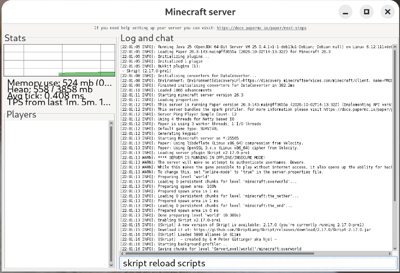

# Creating your first Skript

If you go to the plugins folder, you should see a folder there called `Skript`. Here, there should be a folder called `scripts`. Create a file here. We can call it `myfirstskript.sk`. (All skript mods end with the .sk extension). Open this with an editor like notepad. Now you're ready to write your first mod!

Let's write a mod that makes snowballs deadly!
```sk
# Anything after a '#' is a comment and will be ignored by the computer
# Here we are waiting for a projectile to hit something
on projectile hit:
    # If that projectile is a snowball, we create an explosion
    if event-projectile is a snowball:
        make an explosion of force 5 at event-projectile
        # We also delete the event-projectile. See what happens if we don't!
        delete event-projectile
```

To make sure the most up-to-date version of your mod is running, go to the server console and type `skript reload scripts`.



Alternatively, you can `op` yourself by typing `op <username>` in the console to give yourself admin powers. Then, you can run `/skript reload scripts` from minecraft itself as a minecraft command.