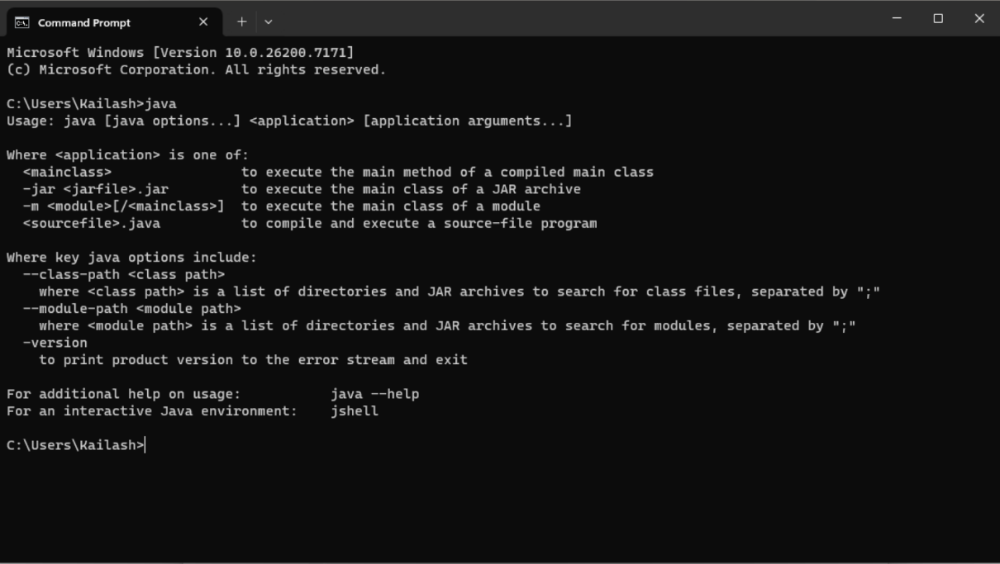

# Getting Started

What you need to install

|Software|Description|
|-|-|
|[Java](https://www.oracle.com/java/technologies/downloads/)|This is required to run any java program like a minecraft server.|
|[Paper MC](https://papermc.io/downloads/paper)|This is a modded minecraft server that let's you run 'plugins' that customize the game.|
|[Skript](https://github.com/skriptlang/skript/releases)|This is the minecraft plugin that makes it much easier to modify minecraft behaviour|

To check if you have java installed, open your command prompt/terminal and type `java`
 If get an output like in the screenshot, it means that you have java.

Make sure to download [paper-mc](https://papermc.io/downloads/paper) and the [skript plugin](https://github.com/skriptlang/skript/releases). Then, place the paper-mc jar file you downloaded in some directory and run it here. This will generate a bunch of files including a file called `eula.txt`. It should look something like this.
```txt
#By changing the setting below to TRUE you are indicating your agreement to our EULA (https://aka.ms/MinecraftEULA).
#Fri Oct 02 20:17:28 IST 2026
eula=false
```

Change the line that says `eula=false` to `eula=true`. Doing this means you're agreeing to the [minecraft eula](https://www.minecraft.net/en-us/eula) (these are just the legal terms and conditions that you need to agree on so you can run a minecraft server).

Another file you should see is `server.properties`. This is a configuration file with multiple options. For example, there is the `MOTD`, or message of the day. This controls the descriptions of the server you see in the multiplayer menu. There is also `online-mode`. This let's you choose if you want your server to authenticate users or not. Setting `online-mode` to false lets players without official Minecraft accounts join your server. 

Finally, a folder called plugins should be created. Place the `skript plugin jar` you downloaded in this folder.

Once you've agreed to the eula, if you run the paper mc jar file, the server should start and you will be able to join it from your minecraft client if you connect to `localhost` or `127.0.0.1`.